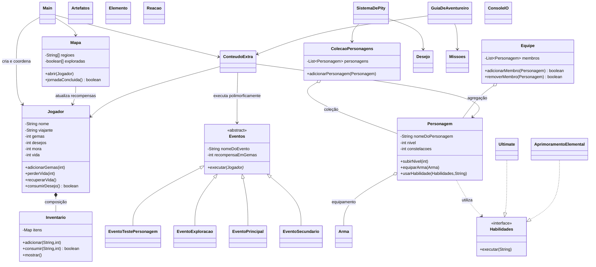

# Diagrama de classes — Aventura da Viajante

O diagrama abaixo destaca as classes e relações principais do projeto. As setas de herança apontam para a classe geral; a linha tracejada representa implementação de interface.

